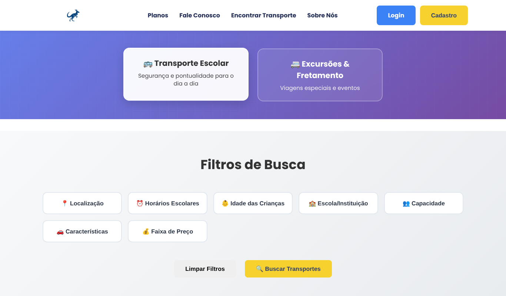
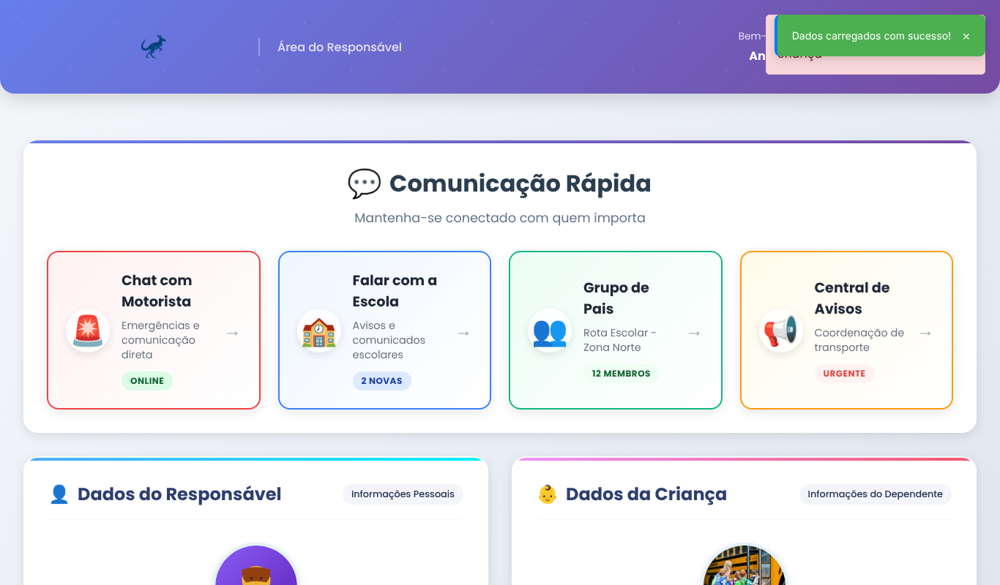

# Kanghoo — School Transport Management Platform

Kanghoo connects school-transport drivers with parents. Drivers manage their vehicles, routes and passenger lists; parents find a transport service, register their children and follow the route in real time.

Built as the capstone project of the **Jovem Programador** program (SENAC Santa Catarina, 2025). It was a team project, and I ([Matheus Rocha da Silva](https://www.linkedin.com/in/matheus-rocha-da-silva-/)) was the lead developer and wrote most of the codebase.


## Features

**For parents**
- Sign up, log in and register children
- Search school transport by location, school schedule, children's age, school, capacity and price
- Parent area with driver, child and route information

**For drivers**
- Sign up with personal and vehicle data (plate, RENAVAM, capacity)
- Create and manage school routes, with route limits based on the subscription plan
- Add and remove children from routes, with pick-up and drop-off points
- Send GPS position updates during trips

**Platform**
- JWT authentication with role-based access (parent, school driver, excursion driver)
- Real-time notifications and tracking over WebSocket (Socket.IO)
- Rate limiting, input validation, password hashing (bcrypt) and security headers
- Google Maps integration for routes and location search

| Find transport | Parent area |
| --- | --- |
|  |  |

## Tech stack

| Layer | Technologies |
| --- | --- |
| Backend | Node.js 18+, Koa, Socket.IO, JWT, bcryptjs |
| Database | PostgreSQL |
| Frontend | HTML, CSS, vanilla JavaScript |
| Integrations | Google Maps API, Nodemailer |
| Tests | Mocha, Chai, Sinon |
| Infrastructure | Docker, Docker Compose, Nginx, Prometheus, Grafana |

## Project structure

```
├── frontend/public/   Static pages (home, search, plans, login and user areas)
├── server/
│   ├── server.js      Koa app: middleware, auth routes, static files
│   ├── routes/        REST API (routes, children, tracking, plans, notifications)
│   ├── realtime/      WebSocket server, notification hub, tracking integration
│   ├── config/        Database, security, upload and Maps configuration
│   ├── middleware/    Auth, validation and upload security
│   ├── utils/         Logger, cache, validators, GPS and notification services
│   ├── scripts/       Database setup and migration scripts
│   └── tests/         Unit tests
├── database/          SQL schema and migrations
├── docs/              Technical documentation (Portuguese) and screenshots
└── docker-compose.yml Local stack with PostgreSQL, Redis, Nginx and monitoring
```

## Running locally

**Requirements:** Node.js 18+ and PostgreSQL 13+.

```bash
# 1. Install dependencies
cd server
npm install

# 2. Configure environment variables
cp .env.example .env
# Edit .env: database credentials, and generate new secrets with
#   openssl rand -hex 32   (for JWT_SECRET and SESSION_SECRET)

# 3. Create the database and tables
createdb kanghoo_db_prod
node scripts/database/migrations/criar-tabelas-completas.js
node scripts/database/migrations/melhorar-rastreamento.js

# 4. Start the server
npm start
```

Open http://localhost:3000 and create an account on the sign-up page.

## Tests

```bash
cd server
npm test
```

76 unit tests cover the WebSocket manager, notification hub and security manager.

## Project status

This is an academic project and is **not production-ready**. Sign-up, login, the parent and driver areas, route management and the tracking API work against a local database. Some known limitations:

- Some dashboard widgets (chat, parent groups, notices) still show placeholder data
- Real-time GPS needs a Google Maps API key and a device sending positions
- There are no integration tests yet for the HTTP API
- Code comments and the documentation in `docs/` are in Portuguese

## License

Developed for educational purposes as part of the SENAC Jovem Programador program.
